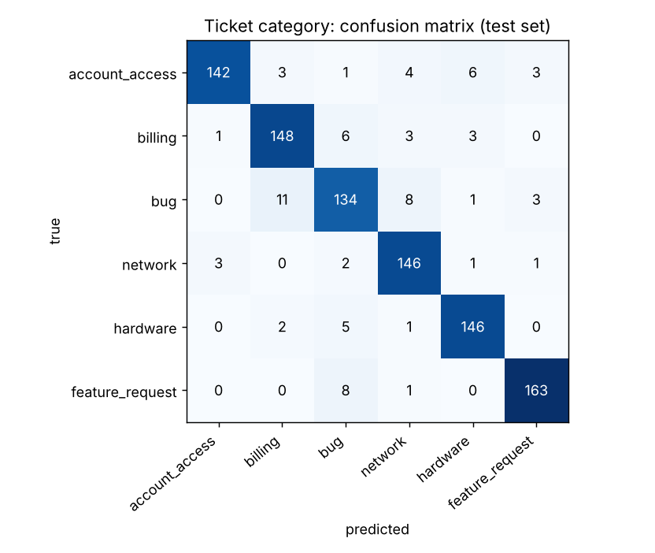

# Support Ticket Classifier (English + German)

A small NLP service that reads a support ticket and predicts its **category** (account access,
billing, bug, network, hardware, feature request) and **priority** (low, medium, high). It works on
English and German text, returns a confidence score, and flags uncertain tickets for a human. It
runs as a REST API (FastAPI) in Docker, and GitHub Actions tests and builds it on every push.

## Why

Helpdesks spend real time sorting incoming tickets before anyone starts solving them. Automatic
routing helps only if it is right, so the service only auto-routes tickets it is confident about
and sends the rest to a person.

## How it works

- **Data**: `tickets/data.py` generates 3,000 realistic tickets (60% English, 40% German) with
  greetings, typos, sentences that mention other categories, missing urgency cues, and 8% noisy
  priority labels. *The data is synthetic*, because real tickets contain customer data.
- **Fair test set**: whole phrasings are held out. Every sentence pattern in the test set is one
  the model never saw in training, so the score measures generalisation, not memorisation. (With a
  random split the same model scores a meaningless 100%.)
- **Model**: TF-IDF on word 1–2-grams plus character 3–5-grams (robust to typos and German compound
  words) feeding a linear classifier, one model per target. Four models are compared with grouped
  5-fold cross-validation.
- **Routing**: tickets with category confidence below 0.5 get `needs_review: true`.

## Results

Test set: 956 tickets with unseen phrasings.

| | Category | Priority |
|---|---|---|
| Accuracy | **91.9%** | **82.3%** |
| Macro F1 | 0.919 | 0.822 |
| English / German accuracy | 93.8% / 89.4% | 82.2% / 82.5% |

Cross-validated macro F1 on the training split:

| Model | Category | Priority |
|---|---|---|
| Majority class (baseline) | 0.05 | 0.20 |
| Naive Bayes | 0.83 | 0.79 |
| Linear SVM | 0.96 | 0.82 |
| Logistic Regression (deployed) | 0.94 | 0.81 |

Linear SVM is slightly better, but Logistic Regression gives probabilities, which the routing
needs. With the 0.5 threshold, **84% of tickets are routed automatically and 98.9% of those are
correct**; the remaining 16% go to a human.



Most mistakes are bugs confused with billing or network issues ("the invoice page gives error 500"
is genuinely both). Priority is capped by the data itself: 15% of tickets state no urgency and 8%
have inconsistent labels.

## Run it

```bash
python -m venv .venv && source .venv/bin/activate      # Windows: .venv\Scripts\activate
pip install -r requirements-dev.txt
python -m tickets.train                                 # trains, prints results, writes reports/
uvicorn app.main:app --reload                           # API docs at http://localhost:8000/docs
pytest -q
```

```bash
curl -X POST localhost:8000/predict -H "Content-Type: application/json" \
     -d '{"text": "Mein Laptop geht nicht mehr an, das ganze Team ist blockiert"}'
# {"category":"hardware","category_confidence":0.96,"priority":"high","priority_confidence":0.92,"needs_review":false}
```

With Docker:

```bash
docker build -t ticket-classifier .
docker run -p 8000:8000 ticket-classifier
```

## Project layout

```
tickets/
  data.py     synthetic English/German tickets and the held-out phrasings
  model.py    feature pipeline, candidate models, TicketClassifier
  train.py    cross-validation, training, test report, confusion matrix
app/main.py   FastAPI service (/health, /predict)
tests/        data, model and API tests
Dockerfile    image with the trained model
.github/workflows/ci.yml   tests, Docker build and a smoke test of the running container
```

## Ideas for next steps

- Fine-tune a multilingual transformer (e.g. `distilbert-base-multilingual-cased`) and compare
  accuracy and latency with the linear model.
- Train on a public ticket dataset to check how the approach transfers to real data.
- Log predictions and human corrections to retrain over time.

## License

MIT
